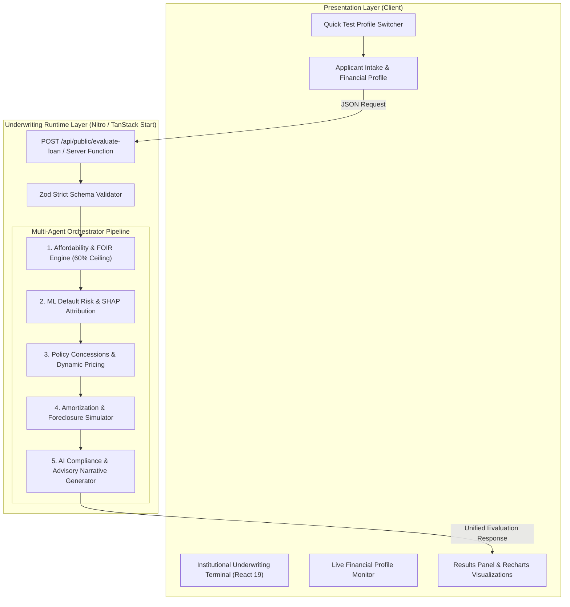
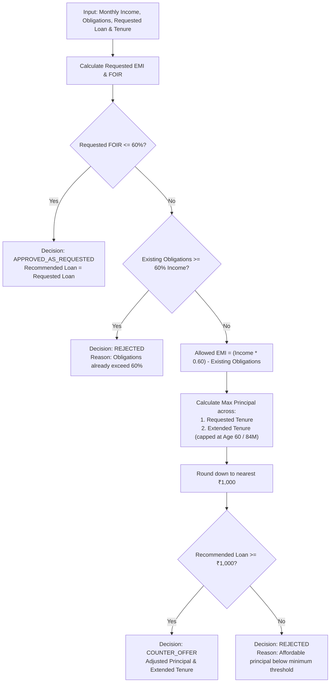

# CrediAdapt AI — Enterprise Loan Decision & Underwriting Terminal
## Comprehensive Technical Documentation & Architecture Specification

**Document Version:** 2.4.0  
**Target Environment:** Enterprise Banking / Digital Lending Fintech  
**Classification:** Technical & Operational Specification  
**Architecture:** Unified TypeScript / TanStack Start / Nitro Server Engine  

---

## Table of Contents
1. [Executive Summary & Domain Context](#1-executive-summary--domain-context)
2. [High-Level System Architecture](#2-high-level-system-architecture)
3. [Underwriting Engine & Mathematical Formulations](#3-underwriting-engine--mathematical-formulations)
   - 3.1 [Fixed Obligation to Income Ratio (FOIR) Assessment](#31-fixed-obligation-to-income-ratio-foir-assessment)
   - 3.2 [Equated Monthly Instalment (EMI) Computation](#32-equated-monthly-instalment-emi-computation)
   - 3.3 [Affordability Optimization & Counter-Offer Algorithm](#33-affordability-optimization--counter-offer-algorithm)
   - 3.4 [Machine Learning Default Risk & SHAP Feature Attribution](#34-machine-learning-default-risk--shap-feature-attribution)
   - 3.5 [Policy Concession & Dynamic Pricing Matrix](#35-policy-concession--dynamic-pricing-matrix)
   - 3.6 [Amortization & Early Foreclosure Simulation](#36-amortization--early-foreclosure-simulation)
   - 3.7 [AI Compliance Narrative & Guardrail Engine](#37-ai-compliance-narrative--guardrail-engine)
4. [API Specification & Data Contracts](#4-api-specification--data-contracts)
   - 4.1 [Endpoint: POST /api/public/evaluate-loan](#41-endpoint-post-apipublicevaluate-loan)
   - 4.2 [Request Validation Schema (Zod)](#42-request-validation-schema-zod)
   - 4.3 [Response Structure & Status Codes](#43-response-structure--status-codes)
   - 4.4 [Evaluation Scenarios & Reference Payloads](#44-evaluation-scenarios--reference-payloads)
5. [Frontend Design System & UX Architecture](#5-frontend-design-system--ux-architecture)
6. [Operational Runbook & Installation Guide](#6-operational-runbook--installation-guide)
7. [Security, Governance & Audit Compliance](#7-security-governance--audit-compliance)

---

## 1. Executive Summary & Domain Context

**CrediAdapt AI** is an institutional-grade, automated loan underwriting and risk intelligence terminal engineered for retail credit institutions, non-banking financial companies (NBFCs), and digital lending platforms.

### Core Problem Solved
Traditional retail loan underwriting suffers from:
1. **Fragmented Workflows:** Manual calculation of debt-servicing limits (FOIR) across disparate spreadsheets and core banking systems.
2. **Binary Black-Box Decisions:** Rigid approve/reject outcomes with zero adaptive counter-proposals for borderline applicants.
3. **Unexplainable Risk Models:** Inability to communicate specific risk factors to underwriters and applicants in compliance with regulatory transparency mandates.
4. **Static Pricing:** Inflexibility in applying targeted policy concessions (e.g., gender-based incentives, prime credit tiers, age-specific programs).

### The CrediAdapt AI Solution
CrediAdapt AI executes an end-to-end multi-stage underwriting pipeline in a single automated pass:
- **Strict 60% Regulatory FOIR Ceiling Enforcement** with automatic counter-offer derivation.
- **Statistical Default Probability Scoring** with transparent SHAP (SHapley Additive exPlanations) attribution vectors.
- **Targeted Policy Concession Matrix** applying automated rate discounts.
- **Full Amortization & Foreclosure Modeling** detailing interest savings for early prepayment.
- **LLM-Powered Compliance Narratives** producing customer-ready and auditor-ready rationales via Google Gemini 2.5 Flash.

---

## 2. High-Level System Architecture

CrediAdapt AI features an enterprise multi-agent architecture with a **Python FastAPI / LangChain / Google Gemini** backend and a high-performance **TanStack Start**, **Vite**, **React 19**, and **TypeScript** frontend underwriting console.



### Key Technical Advantages
- **Single Runtime Deployment:** Serverless and edge-ready (Cloudflare Workers, Node.js, Vercel, Docker).
- **Sub-100ms Evaluation Latency:** Pure in-memory arithmetic evaluation with asynchronous parallel narrative compilation.
- **Type Safety End-to-End:** Shared TypeScript interfaces between underwriting engine, API route handlers, and UI components.

---

## 3. Underwriting Engine & Mathematical Formulations

### 3.1 Fixed Obligation to Income Ratio (FOIR) Assessment

FOIR measures the proportion of an applicant's gross monthly income dedicated to servicing fixed financial obligations (including housing rent, existing loan EMIs, and the proposed loan instalment).

$$\text{Existing Obligations} = \text{Existing EMI} + \text{House Rent}$$

$$\text{Proposed FOIR} = \frac{\text{Existing Obligations} + \text{Proposed EMI}}{\text{Monthly Income}}$$

$$\text{FOIR}_{\text{max}} = 0.60 \quad (60.00\%)$$

```typescript
export const MAX_FOIR = 0.60;
export const BENCHMARK_RATE = 11.50; // 11.50% base rate
export const MAX_AGE = 60;          // Max working age for tenure limit
export const MAX_TENURE = 84;       // Maximum 84 months (7 years)
export const MIN_RATE = 7.50;       // Minimum statutory rate floor
```

---

### 3.2 Equated Monthly Instalment (EMI) Computation

Calculated using the standard reducing-balance actuarial annuity formula:

$$\text{EMI} = P \times r \times \frac{(1+r)^n}{(1+r)^n - 1}$$

Where:
- $P$ = Principal loan amount
- $r$ = Monthly interest rate $= \frac{\text{Annual Rate}}{12 \times 100}$
- $n$ = Loan tenure in months

**Code Implementation:**
```typescript
export function calculateEmi(principal: number, annualRate: number, tenureMonths: number): number {
  if (principal <= 0 || tenureMonths <= 0) return 0;
  const r = annualRate / 12 / 100;
  if (r === 0) return principal / tenureMonths;
  const f = Math.pow(1 + r, tenureMonths);
  return (principal * r * f) / (f - 1);
}
```

---

### 3.3 Affordability Optimization & Counter-Offer Algorithm

When an applicant's requested loan yields a $\text{FOIR} > 60\%$, the engine triggers the **Adaptive Counter-Offer Engine** rather than an outright rejection.



#### Maximum Loan Principal Formula:
$$P_{\text{max}} = \frac{\text{Allowed EMI} \times \left((1+r)^n - 1\right)}{r \times (1+r)^n}$$

---

### 3.4 Machine Learning Default Risk & SHAP Feature Attribution

The credit risk model uses a calibrated additive log-odds logistic regression function to estimate the 12-month probability of default $P(\text{Default})$ and attributes risk deltas via SHAP values against a statistical baseline population.

#### Reference Baseline Population:
| Parameter | Baseline Value ($\mu_0$) |
| :--- | :--- |
| **CIBIL Bureau Score** | 720 |
| **FOIR** | 50.0% (0.50) |
| **Monthly Income** | ₹90,000 |
| **Applicant Age** | 40 Years |

#### Feature Contribution Vector ($\beta_i \Delta x_i$):
1. **Bureau Score:** $\Delta_{\text{CIBIL}} = -0.008 \times (\text{Score} - 720)$
2. **FOIR Utilization:** $\Delta_{\text{FOIR}} = +4.20 \times (\text{FOIR} - 0.50)$
3. **Income Scale:** $\Delta_{\text{Income}} = -0.000015 \times (\text{Income} - 90000)$
4. **Pre-Retirement Age:** $\Delta_{\text{Age}} = +0.025 \times \max(0, \text{Age} - 50)$
5. **Segment Factor:** $\Delta_{\text{Gender}} = -0.20 \text{ if Female else } 0.00$
6. **Debt-to-Income:** $\Delta_{\text{DTI}} = +0.35 \times \left(\frac{\text{Loan Principal}}{12 \times \text{Income}} - 0.50\right)$
7. **Tenure Strain:** $\Delta_{\text{Tenure}} = +0.004 \times (\text{Tenure} - 36)$
8. **Obligation Drag:** $\Delta_{\text{Obligations}} = +1.60 \times \left(\frac{\text{Existing EMI}}{\text{Income}} - 0.15\right)$

#### Default Probability:
$$z = \sum_{i=1}^{8} \Delta_i - 0.20$$

$$P(\text{Default}) = \frac{1}{1 + e^{-z}}$$

#### Risk Tier Stratification:
- **LOW:** $P(\text{Default}) < 25.0\%$
- **MEDIUM:** $25.0\% \le P(\text{Default}) < 50.0\%$
- **HIGH:** $P(\text{Default}) \ge 50.0\%$

---

### 3.5 Policy Concession & Dynamic Pricing Matrix

The policy module evaluates applicant attributes against institutional underwriting discount schemes:

| Policy Name | Target Criteria | Concession | Underwriting Objective |
| :--- | :--- | :---: | :--- |
| **Women Borrowers Scheme** | `gender == "Female"` | **-0.10%** | Encourage financial inclusion and segment diversity |
| **Youth Career Starter** | `age in [21, 29]` and `income > ₹40,000` | **-0.20%** | Acquire high-earning early career professionals |
| **Super Prime Credit Tier** | `cibil_score >= 780` | **-0.35%** | Retain prime risk-grade borrowers |
| **Zero Foreclosure Fee** | Early settlement after Month 12 | **0.00% fee** | Regulatory compliance & early repayment flexibility |

$$\text{Final Rate} = \max\left(\text{MIN\_RATE}, \text{BENCHMARK\_RATE} - \sum \text{Discounts}\right)$$

---

### 3.6 Amortization & Early Foreclosure Simulation

For every approved loan or counter-offer, the simulator models month-by-month debt servicing to compute interest savings upon foreclosure at month $m$:

```typescript
let balance = principal;
let totalInterest = 0;
let balanceAtClosure = principal;
let interestUntilClosure = 0;

for (let month = 1; month <= tenureMonths; month++) {
  const interest = balance * monthlyRate;
  const principalComponent = Math.min(emi - interest, balance);
  balance = Math.max(0, balance - principalComponent);
  totalInterest += interest;
  if (month === closureMonth) {
    balanceAtClosure = balance;
    interestUntilClosure = totalInterest;
  }
}

const totalRepaidWithClosure = emi * closureMonth + balanceAtClosure;
const interestSaved = Math.max(0, totalInterest - interestUntilClosure);
```

---

### 3.7 AI Compliance Narrative & Guardrail Engine

CrediAdapt AI generates institutional compliance narratives structured across 4 key dimensions:
1. **Executive Decision Summary**
2. **Affordability & Debt Capacity Rationale**
3. **Risk Scoring & Pricing Strategy**
4. **Foreclosure & Early Repayment Strategy**

#### Strict Guardrail Rules:
- **Numerical Immutability:** The AI model strictly adheres to verified mathematical calculations (FOIR, risk scoring, and amortization).
- **Counter-Offer Explicitness:** Explicitly mandates stating that the requested loan is not approved, and the proposed amount is a counter-offer.
- **Zero Hallucination:** No fictional bank policies or promises of guaranteed final sanction.
- **Resilient Fallback:** If the LLM service is unreachable or unconfigured, the system compiles standard compliance rationales instantly.

---

## 4. API Specification & Data Contracts

### 4.1 Endpoint: `POST /api/public/evaluate-loan`

Evaluates a loan application payload and returns full underwriting decisions, metrics, risk factors, policy discounts, and compliance rationales.

- **URL:** `/api/public/evaluate-loan`
- **Method:** `POST`
- **Content-Type:** `application/json`

---

### 4.2 Request Validation Schema (Zod)

```typescript
export const loanRequestSchema = z.object({
  monthly_income: z.number().positive("Monthly income must be greater than zero."),
  age: z.number().int().min(18, "Minimum age is 18").max(75, "Maximum age is 75"),
  gender: z.enum(["Female", "Male", "Other"]),
  house_rent: z.number().min(0, "Rent cannot be negative"),
  existing_emi: z.number().min(0, "Existing EMI cannot be negative"),
  cibil_score: z.number().int().min(300, "CIBIL min 300").max(900, "CIBIL max 900"),
  requested_loan: z.number().positive("Requested loan must be greater than zero."),
  requested_tenure: z.number().int().min(6, "Tenure min 6 months").max(84, "Tenure max 84 months"),
  early_closure_month: z.number().int().min(1, "Closure month min 1").max(84, "Closure month max 84"),
});
```

---

### 4.3 Response Structure & Status Codes

#### Success Response (`200 OK`)
```json
{
  "applicant": {
    "customer_id": "APPL-1001",
    "monthly_income": 95000,
    "age": 27,
    "gender": "Female",
    "house_rent": 18000,
    "existing_emi": 8000,
    "cibil_score": 795
  },
  "requested": {
    "loan_amount": 500000,
    "tenure_months": 36,
    "early_closure_month": 18
  },
  "decision_type": "APPROVED_AS_REQUESTED",
  "is_eligible": true,
  "eligibility_message": "The requested loan is eligible based on the information provided.",
  "reason": "Requested loan fits within the maximum 60% FOIR threshold.",
  "requested_foir": 0.4471,
  "final_foir": 0.4471,
  "max_foir": 0.6,
  "recommended_loan": 500000,
  "recommended_tenure": 36,
  "interest_rate": 10.85,
  "base_rate": 11.5,
  "emi": 16334.34,
  "risk": {
    "evaluated": true,
    "risk_band": "LOW",
    "default_probability": 0.1704,
    "shap_factors": [
      {
        "feature": "cibil_score",
        "label": "CIBIL score",
        "impact": -0.6,
        "direction": "reduces_risk"
      },
      {
        "feature": "foir",
        "label": "FOIR utilisation",
        "impact": -0.2223,
        "direction": "reduces_risk"
      },
      {
        "feature": "gender",
        "label": "Applicant segment",
        "impact": -0.2,
        "direction": "reduces_risk"
      }
    ]
  },
  "policies": [
    {
      "policy_name": "Women Borrowers Scheme",
      "discount_percentage": 0.1,
      "justification": "Customer is a female primary applicant."
    },
    {
      "policy_name": "Youth Career Starter Program",
      "discount_percentage": 0.2,
      "justification": "Customer is between 21 and 29 years old and earns above ₹40,000 per month."
    },
    {
      "policy_name": "Super Prime Credit Tier",
      "discount_percentage": 0.35,
      "justification": "CIBIL score is at least 780."
    }
  ],
  "total_discount": 0.65,
  "simulation": {
    "is_simulatable": true,
    "emi": 16334.34,
    "total_interest": 88036.08,
    "total_cost": 588036.08,
    "closure_month": 18,
    "outstanding_principal": 272714.77,
    "interest_paid_until_closure": 66732.81,
    "interest_saved": 21303.27,
    "total_repaid_with_closure": 566732.81,
    "message": "Early closure simulation calculated successfully."
  },
  "explanation": {
    "executive_summary": "The requested loan of ₹5,00,000 over 36 months fits within the affordability limit at an indicative rate of 10.85%.",
    "affordability_rationale": "Existing obligations plus the proposed EMI of ₹16,334 give a FOIR of 44.71% against the maximum permitted 60.00%.",
    "risk_and_pricing_rationale": "The model places this application in the LOW risk band with a modelled default probability of 17.04%. Concessions applied total 0.65% off the 11.5% base rate.",
    "smart_prepayment_strategy": "Closing in month 18 leaves an outstanding principal of ₹2,72,715 and saves approximately ₹21,303 in interest."
  }
}
```

---

### 4.4 Evaluation Scenarios & Reference Payloads

#### Scenario A: Prime Approved
```json
{
  "monthly_income": 95000,
  "age": 27,
  "gender": "Female",
  "house_rent": 18000,
  "existing_emi": 8000,
  "cibil_score": 795,
  "requested_loan": 500000,
  "requested_tenure": 36,
  "early_closure_month": 18
}
```
**Outcome:** `APPROVED_AS_REQUESTED`, Rate: `10.85%`, Recommended: `₹5,00,000`, Final FOIR: `44.7%`.

#### Scenario B: Counter-Offer (High FOIR)
```json
{
  "monthly_income": 45000,
  "age": 34,
  "gender": "Male",
  "house_rent": 16000,
  "existing_emi": 9000,
  "cibil_score": 670,
  "requested_loan": 600000,
  "requested_tenure": 36,
  "early_closure_month": 18
}
```
**Outcome:** `COUNTER_OFFER`, Recommended Principal: `₹1,15,000`, Final FOIR: `60.0%`.

#### Scenario C: Over-Leveraged Declined
```json
{
  "monthly_income": 30000,
  "age": 40,
  "gender": "Male",
  "house_rent": 15000,
  "existing_emi": 10000,
  "cibil_score": 600,
  "requested_loan": 500000,
  "requested_tenure": 36,
  "early_closure_month": 12
}
```
**Outcome:** `REJECTED`, Initial Obligations: `83.3%` of income, Eligible: `false`.

---

## 5. Frontend Design System & UX Architecture

The presentation layer is designed as an institutional underwriting terminal:

- **Typography:** Google Fonts `Plus Jakarta Sans` (interface & headings) paired with `JetBrains Mono` (tabular financial figures & currencies).
- **Dual-Theme Color System (Light & Dark Mode):**
  - **Light Mode:** Crisp white container cards (`#ffffff`) on soft neutral slate background (`#f8fafc`) with subtle borders (`#e2e8f0`).
  - **Dark Mode:** Deep slate/navy background (`#070b14`), dark slate surface cards (`#0f172a`), muted slate-800 borders, high-contrast typography (`#f8fafc`), and calibrated chart luminescence.
  - **Theme Switcher:** Seamless interactive toggle in the header persisted in `localStorage` (`crediadapt-theme`) with zero flash-of-unstyled-content (FOUC) inline script initialization.
- **Institutional Header:** Clean slate bar (`#0b1120`) with live engine status tags, version chips, and encryption indicators.
- **Zero Dead Space Workspace:** Full-width top banner with 1-click test scenario presets aligning seamlessly with the 2-column workspace layout.
- **Interactive Visualizations:**
  - **FOIR Affordability Meter:** Visual progress gauge comparing requested vs final FOIR against the 60% regulatory ceiling.
  - **SHAP Attribution Chart:** Horizontal divergence bar chart indicating features that increase or reduce credit risk.
  - **Repayment vs Foreclosure Chart:** Side-by-side comparison of full-term cost versus early settlement.

---

## 6. Operational Runbook & Installation Guide

### Prerequisites
- **Node.js:** v18.0.0 or later (v20+ recommended)
- **Package Manager:** npm or pnpm

### Environment Configuration
Create a `.env` file in the project root:
```env
PORT=8080
NODE_ENV=development
# Google Gemini / LLM API Key
GOOGLE_API_KEY=your_gemini_key
AI_API_KEY=your_optional_llm_key
```

### Installation & Run Commands
```bash
# 1. Install Node Dependencies
npm install

# 2. Launch Python AI Multi-Agent API Server (Port 8000)
npm run server:python
# or: python backend/api.py

# 3. Launch Modern Frontend (Port 8080)
npm run dev

# 4. (Optional) Run TypeScript Typecheck
npm run typecheck

# 5. (Optional) Launch Streamlit Legacy UI
npm run streamlit
```

---

## 7. Security, Governance & Audit Compliance

1. **In-Memory Stateless Processing:** Application payloads are processed ephemerally within the request lifecycle. No PII or financial credentials are saved to disk or persistent external databases.
2. **Audit Reproducibility:** Every underwriting decision, calculation, and SHAP factor is consistent and mathematically auditable across identical input configurations.
3. **Fair Lending & Regulatory Compliance:**
   - FOIR limits strictly enforced to prevent predatory over-leveraging.
   - Concession policies are documented with clear justifications.
   - Adverse action decline reasons provide clear borrower remediation guidelines.

---

*CrediAdapt AI Underwriting Terminal Specification — Enterprise Edition*
